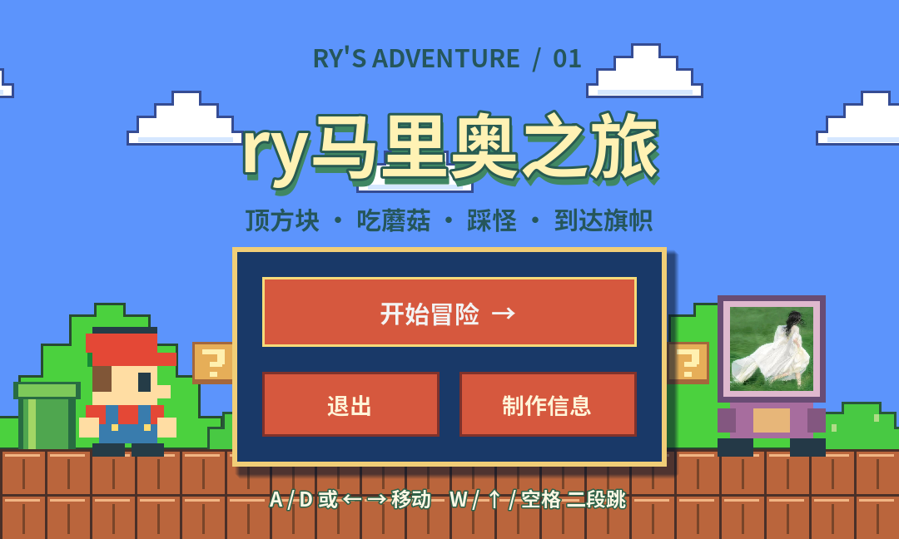
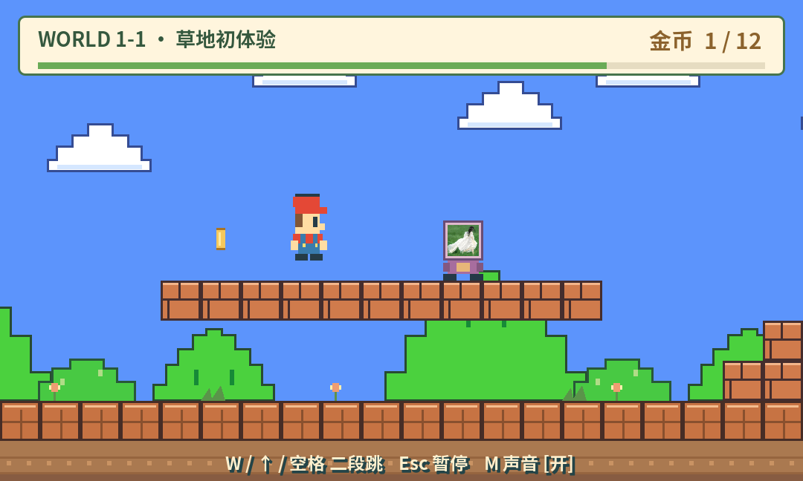

# ry马里奥之旅

一个单关卡横版小游戏。最终程序：`交付/ry马里奥之旅.exe`，双击即玩。图片、头像、字体、音效、地图及许可均嵌入 EXE，不需要外置 PCK、素材目录或 Godot 编辑器，也不需要联网。

**下载：[Windows 单文件 EXE](https://github.com/mengqixi/-/releases/latest)**。在 Releases 页面下载 `ry马里奥之旅.exe`；无需下载源码或其他素材。



## 操作

| 操作 | 按键 |
| --- | --- |
| 左移 / 右移 | A / D 或 ← / → |
| 跳跃 | W、↑ 或空格；轻点低跳，长按高跳，空中再按一次可二段跳 |
| 开始、重试、重玩 | Enter，或点击界面按钮 |
| 暂停、继续 | Esc，切换窗口也会自动暂停 |
| 音效开关 | M |

从起点走到旗帜通关，不要求拿齐金币。总共 12 枚金币：11 枚摆在地图上，1 枚藏在起点附近的幸运方块里。从下方用头顶幸运方块才会释放奖励，每个方块只有一次奖励。第 43 列的幸运方块会放出移动蘑菇。

吃蘑菇后角色变大；大角色碰怪一次变小，并有短暂闪烁保护。小角色碰怪会失败；下落时踩怪可以消灭怪物。掉坑始终失败。重试会重置所有金币、怪物、方块、蘑菇和角色体型。

程序图标及怪物的照片头像由用户提供，怪物身体和小脚独立绘制。画面使用经典蓝天、白云、绿丘、砖块、绿管道和终点城堡。开始、暂停和结果界面已按用户反馈重新排版。

第一关增加三段可以站立和行走的空中砖块平台，部分金币位于高处，第三只怪物在上层平台巡逻。二段跳落地后恢复，空中不能无限连续跳。界面采用与像素关卡一致的方形边框、深蓝底色和等宽对齐按钮。



## 开发与构建

Godot 4.7.2 标准版、GDScript、Compatibility / OpenGL 3.3、Windows x64。终端脚本需要 PowerShell 7；本机用 7.6.5。玩家无需安装这些开发工具。

在 PowerShell 7 中执行：

```powershell
pwsh -NoProfile -File .\tools\build.ps1
```

编辑器在 `.tools/godot/editor/`；Windows x64 导出模板在 `.tools/godot/`。这些开发工具不属于最终交付内容。新开发机器上下载匹配 Godot，运行 `tools/fetch-windows-template.ps1` 获取匹配的发布模板，并给构建脚本传入 `-GodotExe`。模板脚本按 ZIP 字节区间获取所需 Windows 文件，避免下载其他平台模板。

`export_presets.cfg` 启用 `binary_format/embed_pck=true`，禁用控制台包装器、ANGLE 和 D3D12 附属 DLL 导出。目标电脑需要正常的 OpenGL 3.3 显卡驱动。

地图参数位于 `scenes/levels/level_01.tscn`。以后添加第二关可以复制该场景，复用角色与物件；当前只实现第一关。

## 验证

`tests/gameplay.gd` 验证七个实际按键、跳跃高度、怪物接触方向、幸运方块单次奖励、移动蘑菇、体型与碰撞变化、受伤保护、两处深坑、金币、重试重置、暂停恢复，以及从出生点只用移动和跳跃输入走到终点。最后一项没有通过传送完成。

`tests/visual.gd` 生成实际渲染截图，供检查菜单、暂停、顶方块、管道、变大和结果布局。测试工具不会打包到 EXE。再次运行测试前先创建临时 `verification/` 目录；发布时将所需证据保留到 `docs/` 后清理临时目录。

本机已通过 **46 项功能检查**，包括全部移动/跳跃按键、二段跳与次数限制、上层平台站立行走、上层巡逻怪、幸运方块、蘑菇、体型变化、死亡重试、暂停和完整起点到终点路线。保留的结果为 `docs/verification-results.json`。通关路线用输入控制完成；单独物件测试使用定位夹具。测试由 Godot 编辑器运行，正式 Release 模板不执行外部 `--script` 测试文件。

已将 EXE 单独复制进含中文和空格的空目录，从不同工作目录启动，确认只有一个 EXE 时也能出现正常响应的游戏窗口。详细记录见 [验证报告](docs/test-report.md)。另一个物理电脑上的兼容性需要实机验证。

## AI 使用说明

AI 根据课程目标和用户反馈完成技术设计、GDScript 代码、原创像素画面、合成音效、测试与 PowerShell 7 单文件构建流程。用户决定游戏名称、提供图标与头像照片，并提出 UI、按键、经典场景、幸运方块和蘑菇等修改要求。本项目没有游戏内大模型调用。

Godot 与字体许可可在开始界面的“制作信息”中查看，亦保留在源工程 `assets/licenses/`。

调整中文文案后可以运行 `tools/update-font.ps1` 更新内嵌字体字符子集；这个可选开发步骤需要 Python，玩家不需要 Python。
